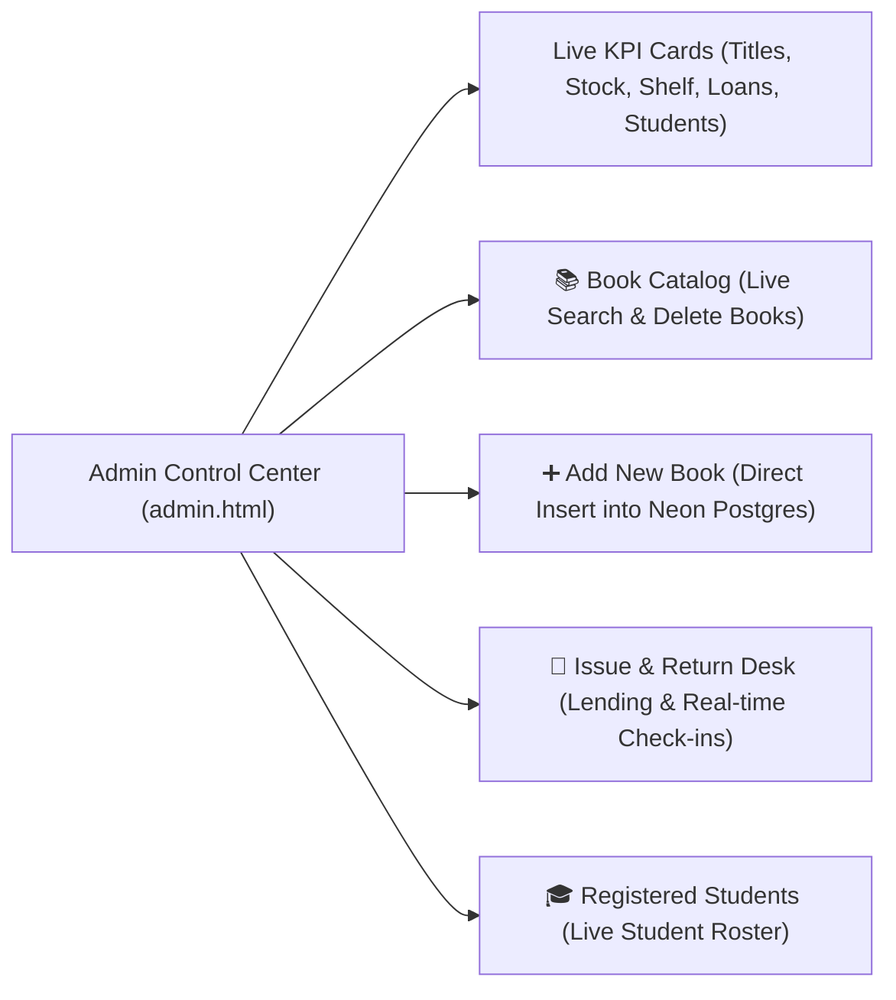

# Smart Library Management System - Complete Technical Documentation
### Cloud Production Edition: Neon Serverless Postgres, Neon Auth & Vercel Serverless Hosting

Welcome to the definitive technical documentation and architectural reference for the **Smart Library Management System** (`SmartLibrary`). This document details the system design, tech stack, cloud PostgreSQL architecture on Neon, serverless hosting on Vercel, dedicated Administrator Control Center, student patron services, real-time AI chatbot, and complete step-by-step execution guide.

---

## Table of Contents
1. [Project Overview & Key Capabilities](#1-project-overview--key-capabilities)
2. [Live Cloud Deployments & URLs](#2-live-cloud-deployments--urls)
3. [High-Level System Architecture](#3-high-level-system-architecture)
4. [Technology Stack](#4-technology-stack)
5. [Live Neon Cloud Database Configuration](#5-live-neon-cloud-database-configuration)
6. [Administrator Control Center (`website/admin.html`)](#6-administrator-control-center-websiteadminhtml)
7. [Single-Admin & Student Registration Architecture](#7-single-admin--student-registration-architecture)
8. [Real-Time Database-Synchronized AI Assistant](#8-real-time-database-synchronized-ai-assistant)
9. [Complete API & Interface Reference](#9-complete-api--interface-reference)
   - [9.1 Administrative Management Endpoints](#91-administrative-management-endpoints)
   - [9.2 Catalog & Patron Endpoints](#92-catalog--patron-endpoints)
   - [9.3 Neon Auth Endpoints](#93-neon-auth-endpoints)
10. [File-by-File Purpose & Code Analysis](#10-file-by-file-purpose--code-analysis)
11. [How to Connect and Use the Admin Portal](#11-how-to-connect-and-use-the-admin-portal)
12. [Build, Verification & Deployment Guide](#12-build-verification--deployment-guide)

---

## 1. Project Overview & Key Capabilities

The **Smart Library Management System** is a full-stack, cloud-native educational library application backed by **Neon Serverless Postgres** (`production` branch) and hosted globally on **Vercel Serverless Functions**.

### Key System Capabilities:
1. **Dedicated Administrator Control Center (`website/admin.html`)**: Real-time KPI dashboard, dynamic book catalog management (live CRUD), circulation desk (issue and return workflow), and registered student rosters.
2. **Neon Serverless Postgres**: Live cloud database utilizing connection pooling (`DATABASE_URL`) for serverless web queries and unpooled direct connections (`DATABASE_URL_UNPOOLED`) for migrations.
3. **Strict Single-Admin Architecture**: Enforces via database constraints and server middleware that only **one single Administrator account** exists across the entire system. Public registration is strictly reserved for Student Patrons.
4. **Real-Time Synchronized AI Assistant (`chatbot/chatbot.html`)**: In-browser natural language assistant connected directly to live Neon PostgreSQL via `/api/books`, supporting bidirectional sentence matching, stock checks, author queries, and recommendation engines.
5. **Hybrid Execution (Local + Cloud)**: Fully operational locally on Node.js / Express and globally distributed on Vercel Serverless Functions.

---

## 2. Live Cloud Deployments & URLs

The application is deployed live in production:

| Service | Live Production URL | Notes |
| :--- | :--- | :--- |
| **Production Home** | [https://smartlibrary-olive.vercel.app](https://smartlibrary-olive.vercel.app) | Public Landing Page |
| **Admin Portal** | [https://smartlibrary-olive.vercel.app/website/admin.html](https://smartlibrary-olive.vercel.app/website/admin.html) | Control Center for Administrator |
| **Sign In / Register** | [https://smartlibrary-olive.vercel.app/website/login.html](https://smartlibrary-olive.vercel.app/website/login.html) | Patron & Admin authentication |
| **Student Portal** | [https://smartlibrary-olive.vercel.app/website/student.html](https://smartlibrary-olive.vercel.app/website/student.html) | Live catalog search & shelf availability |
| **AI Assistant** | [https://smartlibrary-olive.vercel.app/chatbot/chatbot.html](https://smartlibrary-olive.vercel.app/chatbot/chatbot.html) | Database-synced AI chatbot |
| **PostgreSQL Health API** | [https://smartlibrary-olive.vercel.app/api/health](https://smartlibrary-olive.vercel.app/api/health) | Live DB ping & table statistics |
| **GitHub Repository** | [https://github.com/PranavMaske0136/SmartLibrary](https://github.com/PranavMaske0136/SmartLibrary) | Continuous Deployment source |

---

## 3. High-Level System Architecture

```mermaid
graph TD
    subgraph Client_Presentation ["Client Presentation Layer (Browser)"]
        UI_Home["Landing Page<br/>(website/index.html)"]
        UI_Auth["Unified Sign In / Register<br/>(website/login.html)"]
        UI_Admin["Admin Control Center<br/>(website/admin.html & admin.js)"]
        UI_Student["Student Portal<br/>(website/student.html & student.js)"]
        UI_Chatbot["AI Library Assistant<br/>(chatbot/chatbot.html & chatbot.js)"]
    end

    subgraph Hosting_Vercel ["Vercel Global Cloud Edge"]
        VercelRouter["Vercel CDN & Routing Engine<br/>(vercel.json)"]
        ServerlessApp["Serverless Function Gateway<br/>(api/index.js -> server.js)"]
    end

    subgraph Neon_Cloud ["Neon Cloud Platform (super-cherry-81980462)"]
        Branch_Prod["PostgreSQL Branch: production"]
        PG_Books[("books table (Catalog & Stock)")]
        PG_Students[("students table (1 Admin + Students)")]
        PG_Circulation[("issue_returns table (Circulation)")]
        NeonAuthService["Neon Auth (Managed Better Auth)"]
    end

    UI_Home --> VercelRouter
    UI_Auth --> VercelRouter
    UI_Admin --> VercelRouter
    UI_Student --> VercelRouter
    UI_Chatbot --> VercelRouter

    VercelRouter -->|Static Assets| UI_Home
    VercelRouter -->|API Traffic /api/*| ServerlessApp

    ServerlessApp -->|Pooled Connection (TLS)| Branch_Prod
    Branch_Prod --> PG_Books
    Branch_Prod --> PG_Students
    Branch_Prod --> PG_Circulation
    ServerlessApp -.->|JWKS Verification| NeonAuthService
```

---

## 4. Technology Stack

| Layer | Component | Version / Identifier | Purpose & Specifications |
| :--- | :--- | :--- | :--- |
| **Cloud Hosting** | Vercel Serverless | Node.js 26.x Runtime | Zero-config serverless function deployment with Edge CDN asset distribution. |
| **Cloud Database** | Neon Serverless Postgres | `super-cherry-81980462` | Serverless PostgreSQL in AWS `ap-southeast-2` with autoscaling and connection pooling. |
| **Cloud Auth** | Neon Auth | Managed Better Auth | Token signing and identity verification over standard JWKS. |
| **Backend Framework** | Node.js & Express 5 | Express `^5.3.0` | Dual-mode application server (runs standalone locally or serverless on Vercel). |
| **Database Driver** | `@neondatabase/serverless` | `^1.2.0` | Neon's official driver using WebSockets and HTTP pipelining for low latency. |
| **Frontend Stack** | HTML5, CSS3, Modern JS | Vanilla ES6+ | Responsive responsive web application with zero heavy client frameworks. |
| **Native C++ Engine** | C++11 with CMake | MinGW-w64 / CMake 4.4 | Low-level native binary option linked with `libpq` and `ws2_32`. |

---

## 5. Live Neon Cloud Database Configuration

The application is provisioned and deployed to your live Neon account:

* **Organization**: `org-square-bird-49676587`
* **Project ID**: `super-cherry-81980462`
* **Branch**: `production`
* **Database Name**: `neondb`
* **Database Username**: `neondb_owner`
* **Pooled Endpoint**: `ep-polished-meadow-a7lc409z-pooler.ap-southeast-2.aws.neon.tech`
* **Unpooled Endpoint**: `ep-polished-meadow-a7lc409z.ap-southeast-2.aws.neon.tech`
* **Neon Auth Base URL**: `https://ep-polished-meadow-a7lc409z.neonauth.ap-southeast-2.aws.neon.tech/neondb/auth`
* **Neon Auth JWKS URL**: `https://ep-polished-meadow-a7lc409z.neonauth.ap-southeast-2.aws.neon.tech/neondb/auth/.well-known/jwks.json`

---

## 6. Administrator Control Center (`website/admin.html`)

The dedicated **Admin Control Center** provides a single centralized cockpit for library management:



### Dashboard Capabilities:
1. **Live Real-Time KPIs**: Dynamically computed from Neon PostgreSQL (`totalTitles`, `totalCopies`, `availableCopies`, `activeLoans`, `totalStudents`).
2. **Book Catalog Management**: Search titles, inspect quantity vs. on-shelf copies, and delete books safely (guarded against active loans).
3. **Add New Book**: Real-time form with instant validation that inserts new titles into Neon Postgres.
4. **Issue & Return Circulation Desk**:
   - Issue book modal dynamically querying available stock and registered students.
   - Active borrowing table with **"Mark Returned ✓"** action that updates loan status to `returned` and restores shelf stock.
5. **Student Patron Roster**: Inspects enrolled students with Student Code, contact details, and registration dates.

---

## 7. Single-Admin & Student Registration Architecture

* **Database-Level Constraint**:
  ```sql
  CREATE UNIQUE INDEX idx_single_admin ON students(role) WHERE role = 'admin';
  ```
  Guarantees that no more than one admin record can ever exist in PostgreSQL.

* **Sole Administrator Identity**:
  - 👤 **Name**: `Administrator`
  - 🛡️ **Email**: `admin@smartlibrary.edu`
  - 🔑 **Password**: `admin123`
  - 🆔 **Staff Code**: `ADM001`
  - 🏷️ **Role**: `admin`

* **Public Student Registration**:
  - Open to student patrons.
  - Automatically receives `role = 'student'`.
  - Rejects any attempt to register with admin credentials or administrator staff IDs.

---

## 8. Real-Time Database-Synchronized AI Assistant

Located at [`chatbot/chatbot.html`](file:///c:/Users/Pranav%20Maske/OneDrive/Desktop/SmartLibrary/chatbot/chatbot.html):

* **Direct Live Database Connection**: Fetches `/api/books` on initialization and auto-syncs before every response.
* **Natural Sentence Matching**: Supports conversational questions:
  - *"Do you have Bahadur Pranav?"* -> Matches book title
  - *"Books by Pranav Maske"* -> Searches author
  - *"Is Clean Code available?"* -> Queries real-time shelf availability
  - *"Recommend a biography book"* -> Searches by genre/category
* **Live Status Indicator**: Displays `● Online | Live Database (X Books Synced)` in the chatbot header.

---

## 9. Complete API & Interface Reference

### 9.1 Administrative Management Endpoints

| Method | Endpoint | Description |
| :--- | :--- | :--- |
| `GET` | `/api/admin/overview` | Retrieves catalog metrics, available copies, active loans, and student counts. |
| `GET` | `/api/admin/books` | Retrieves full catalog for administration. |
| `POST` | `/api/admin/books` | Inserts a new book into the Neon Postgres `books` table. |
| `DELETE` | `/api/admin/books/:id` | Deletes a book record (fails if active loans exist). |
| `GET` | `/api/admin/students` | Retrieves all registered student patron profiles. |
| `GET` | `/api/admin/issues` | Retrieves all circulation records with joined book and student details. |
| `POST` | `/api/admin/issue` | Issues a book to a student, decrementing `available_copies`. |
| `POST` | `/api/admin/return` | Marks a loan as `returned` and increments `available_copies`. |

### 9.2 Catalog & Patron Endpoints

| Method | Endpoint | Description |
| :--- | :--- | :--- |
| `GET` | `/api/health` | Live PostgreSQL ping, server time, branch, and database table statistics. |
| `GET` | `/api/books` | Retrieves all books with optional `?category=` and `?available=` filters. |
| `GET` | `/api/books/search` | Multi-field search (`?q=`) across titles, authors, and categories. |
| `POST` | `/api/auth/register` | Registers a new student patron account in Neon Postgres. |
| `POST` | `/api/auth/login` | Authenticates administrator or student against Neon Postgres. |

### 9.3 Neon Auth Endpoints

| Method | Endpoint | Description |
| :--- | :--- | :--- |
| `GET` | `/api/auth/config` | Exposes configured `NEON_AUTH_BASE_URL` and `NEON_AUTH_JWKS_URL`. |
| `GET` | `/api/auth/verify-jwks` | Queries Neon Auth's JWKS endpoint to verify token signing keys are operational. |

---

## 10. File-by-File Purpose & Code Analysis

| File / Path | Responsibility & Contents |
| :--- | :--- |
| [`server.js`](file:///c:/Users/Pranav%20Maske/OneDrive/Desktop/SmartLibrary/server.js) | Central Express server exposing administrative and catalog APIs over `@neondatabase/serverless`. Compatible with local Node and Vercel serverless. |
| [`api/index.js`](file:///c:/Users/Pranav%20Maske/OneDrive/Desktop/SmartLibrary/api/index.js) | Serverless Function entry point exporting `app` for Vercel. |
| [`vercel.json`](file:///c:/Users/Pranav%20Maske/OneDrive/Desktop/SmartLibrary/vercel.json) | Vercel routing rules, `/api/*` rewrites, and static asset bundle configuration. |
| [`.vercelignore`](file:///c:/Users/Pranav%20Maske/OneDrive/Desktop/SmartLibrary/.vercelignore) | Protects `.env`, `.git`, and C++ binary build files from deployment. |
| [`website/index.html`](file:///c:/Users/Pranav%20Maske/OneDrive/Desktop/SmartLibrary/website/index.html) | Public Landing Page introducing library services. |
| [`website/admin.html`](file:///c:/Users/Pranav%20Maske/OneDrive/Desktop/SmartLibrary/website/admin.html) | Single-pane Control Center UI for the Administrator. |
| [`website/admin.js`](file:///c:/Users/Pranav%20Maske/OneDrive/Desktop/SmartLibrary/website/admin.js) | Client logic for KPI dashboards, catalog CRUD, and issue/return desks. |
| [`website/student.html`](file:///c:/Users/Pranav%20Maske/OneDrive/Desktop/SmartLibrary/website/student.html) | Patron portal with live book search, category dropdowns, and stock badges. |
| [`website/student.js`](file:///c:/Users/Pranav%20Maske/OneDrive/Desktop/SmartLibrary/website/student.js) | Dynamic book search and live Neon PostgreSQL fetching. |
| [`website/login.html`](file:///c:/Users/Pranav%20Maske/OneDrive/Desktop/SmartLibrary/website/login.html) | Unified authentication screen with Sign In and Student Registration tabs. |
| [`website/website.js`](file:///c:/Users/Pranav%20Maske/OneDrive/Desktop/SmartLibrary/website/website.js) | Authentication handler, form validators, and role-based redirect routing. |
| [`chatbot/chatbot.html`](file:///c:/Users/Pranav%20Maske/OneDrive/Desktop/SmartLibrary/chatbot/chatbot.html) | Conversational AI Assistant UI with live status indicator. |
| [`chatbot/chatbot.js`](file:///c:/Users/Pranav%20Maske/OneDrive/Desktop/SmartLibrary/chatbot/chatbot.js) | AI Assistant logic with background `/api/books` database synchronization. |
| [`backend/database/schema.sql`](file:///c:/Users/Pranav%20Maske/OneDrive/Desktop/SmartLibrary/backend/database/schema.sql) | PostgreSQL DDL definitions for books, students, circulation, and constraints. |
| [`scripts/build.js`](file:///c:/Users/Pranav%20Maske/OneDrive/Desktop/SmartLibrary/scripts/build.js) | Production build verification script ensuring syntax and file integrity. |
| [`scripts/migrate.js`](file:///c:/Users/Pranav%20Maske/OneDrive/Desktop/SmartLibrary/scripts/migrate.js) | Schema migration script for applying DDL to Neon PostgreSQL. |
| [`scripts/test-services.js`](file:///c:/Users/Pranav%20Maske/OneDrive/Desktop/SmartLibrary/scripts/test-services.js) | Comprehensive 20/20 automated test suite for DB queries, inserts, and auth. |

---

## 11. How to Connect and Use the Admin Portal

### Option A: Via Live Production Website (Vercel)
1. Open the Sign In page:  
   👉 **[https://smartlibrary-olive.vercel.app/website/login.html?role=admin](https://smartlibrary-olive.vercel.app/website/login.html?role=admin)**
2. Enter Administrator Credentials:
   - **Email**: `admin@smartlibrary.edu`
   - **Password**: `admin123`
3. Click **Sign In →**.
4. You are automatically routed to the **Admin Control Center**:  
   👉 **[https://smartlibrary-olive.vercel.app/website/admin.html](https://smartlibrary-olive.vercel.app/website/admin.html)**

### Option B: Via Local Development Server
1. Start the server:
   ```powershell
   npm start
   ```
2. Open in browser:  
   👉 `http://localhost:3000/website/login.html?role=admin`
3. Enter credentials and click **Sign In →**.

---

## 12. Build, Verification & Deployment Guide

### Run Production Build Verification
```powershell
npm run build
```

### Run End-to-End Test Suite (20/20 Tests)
```powershell
npm run test:services
```

### Apply Database Migrations to Neon Postgres
```powershell
npm run db:migrate
```

### Deploy to Production on Vercel
```powershell
vercel --prod
```

### Push to GitHub (Triggers Auto-Deployment)
```powershell
git add .
git commit -m "Your update message"
git push origin main
```

---
*Documentation maintained for Smart Library Management System (Neon & Vercel Production Edition).*
