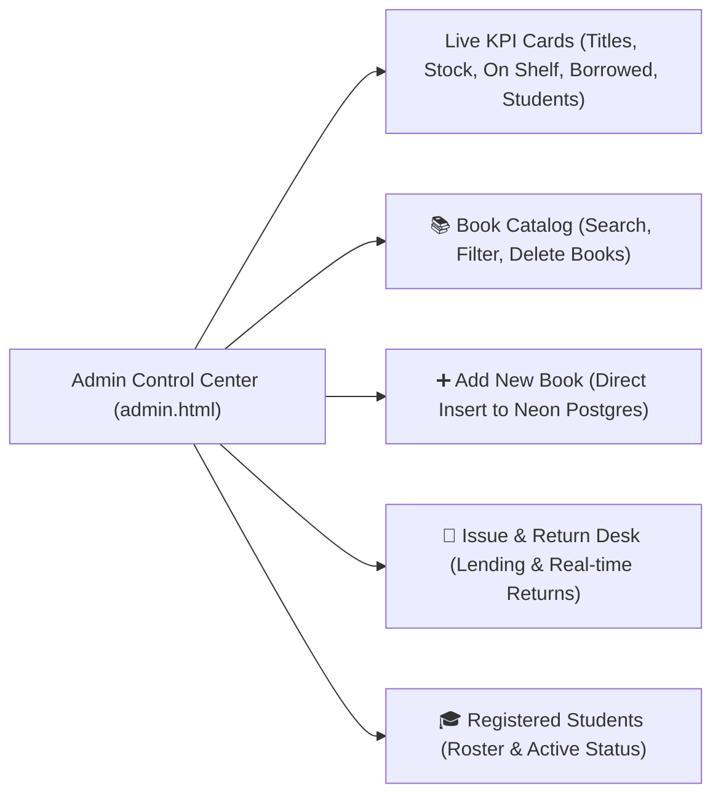

# Smart Library Management System - Comprehensive Technical Documentation
### Neon Serverless Postgres Edition with Dedicated Admin Control Center

Welcome to the central technical documentation and architectural reference for the **Smart Library Management System** (`SmartLibrary`). This document details the system design, tech stack, PostgreSQL database architecture on Neon, the dedicated Administrator Control Center, student patron services, and step-by-step execution guide.

---

## Table of Contents
1. [Project Overview](#1-project-overview)
2. [High-Level System Architecture](#2-high-level-system-architecture)
3. [Technology Stack](#3-technology-stack)
4. [Live Neon Cloud Database Configuration](#4-live-neon-cloud-database-configuration)
5. [Administrator Control Center (`website/admin.html`)](#5-administrator-control-center-websiteadminhtml)
6. [Single-Admin & Student Registration Architecture](#6-single-admin--student-registration-architecture)
7. [API & Interface Reference](#7-api--interface-reference)
   - [7.1 Administrative Management Endpoints](#71-administrative-management-endpoints)
   - [7.2 Catalog & Patron Endpoints](#72-catalog--patron-endpoints)
   - [7.3 Neon Auth Endpoints](#73-neon-auth-endpoints)
8. [File-by-File Purpose & Code Analysis](#8-file-by-file-purpose--code-analysis)
9. [How to Connect and Use the Admin Portal](#9-how-to-connect-and-use-the-admin-portal)
10. [Build, Verification & Execution Guide](#10-build-verification--execution-guide)

---

## 1. Project Overview

The **Smart Library Management System** is a complete, multi-tiered library platform backed by **Neon Serverless Postgres** (`production` branch) and **Neon Auth**.

Key capabilities:
1. **Dedicated Administrator Control Center (`website/admin.html`)**: Real-time KPI dashboard, book catalog management (add/delete books), issue and return desk (lending circulation), and registered student rosters.
2. **Neon Serverless Postgres**: Live cloud database using connection pooling (`DATABASE_URL`) for web queries and direct unpooled connections (`DATABASE_URL_UNPOOLED`) for schema migrations.
3. **Strict Single-Admin Architecture**: Enforces that only **one single Administrator account** exists across the entire system. Public registration is strictly reserved for Student Patrons.
4. **Patron Discovery & AI Assistant**: Interactive student portal with real-time filtering, stock badges, and an in-browser conversational assistant.

---

## 2. High-Level System Architecture

```mermaid
graph TD
    subgraph Client_Presentation ["Web Presentation Layer (Browser)"]
        UI_Home["Landing Page<br/>(website/index.html)"]
        UI_Auth["Unified Sign In / Register<br/>(website/login.html)"]
        UI_Admin["Admin Control Center<br/>(website/admin.html & admin.js)"]
        UI_Student["Student Portal<br/>(website/student.html & student.js)"]
        UI_Chatbot["AI Assistant<br/>(chatbot/chatbot.html)"]
    end

    subgraph App_Server ["Node.js Application Server (server.js)"]
        APIRouter["Express API Gateway"]
        AdminAPIs["Admin Management APIs<br/>(/api/admin/*)"]
        PublicAPIs["Catalog & Auth APIs<br/>(/api/books, /api/auth/*)"]
        NeonDriver["@neondatabase/serverless<br/>(Pooled Connection via DATABASE_URL)"]
    end

    subgraph Neon_Cloud ["Neon Cloud Platform (super-cherry-81980462)"]
        Branch_Prod["Branch: production"]
        PG_Books[("books table (25+ Titles)")]
        PG_Students[("students table (1 Admin + Students)")]
        PG_Circulation[("issue_returns table (Lending & Returns)")]
        NeonAuthService["Neon Auth (Managed Better Auth)"]
    end

    UI_Home --> UI_Auth
    UI_Auth -->|Role: Admin| UI_Admin
    UI_Auth -->|Role: Student| UI_Student
    UI_Home --> UI_Chatbot

    UI_Admin <--> AdminAPIs
    UI_Student <--> PublicAPIs
    UI_Chatbot <--> PublicAPIs

    APIRouter --> AdminAPIs
    APIRouter --> PublicAPIs
    AdminAPIs --> NeonDriver
    PublicAPIs --> NeonDriver

    NeonDriver -->|TLS Connection (Port 5432)| Branch_Prod
    Branch_Prod --> PG_Books
    Branch_Prod --> PG_Students
    Branch_Prod --> PG_Circulation
    APIRouter -.->|JWKS Verification| NeonAuthService
```

---

## 3. Technology Stack

| Layer | Component | Version / Tool | Purpose & Details |
| :--- | :--- | :--- | :--- |
| **Database** | Neon Serverless Postgres | Project `super-cherry-81980462` | Serverless Postgres on AWS `ap-southeast-2` with instant branching, single-admin index, and pooled connections. |
| **Auth Provider** | Neon Auth | Managed Better Auth | Token verification and identity provider endpoints. |
| **Application Server** | Node.js / Express | Node v26.13, Express 5 | REST API gateway, static web server, and Neon serverless driver integration. |
| **Database Driver** | `@neondatabase/serverless` | v1.2.0 | Neon's official serverless driver with built-in connection pooling over WebSocket and HTTP. |
| **Frontend** | HTML5 / CSS3 / Vanilla JS | Modern ES6+ | Single-page admin control center, student portal, and conversational assistant. |
| **Native C++ Engine** | C++11 with CMake | MinGW-w64 / CMake 4.4 | Low-level server engine linked with `libpq` and `ws2_32`. |

---

## 4. Live Neon Cloud Database Configuration

The application is deployed to your live Neon account:

* **Organization**: `org-square-bird-49676587`
* **Project ID**: `super-cherry-81980462`
* **Branch**: `production`
* **Database Name**: `neondb`
* **Database Username**: `neondb_owner`
* **Pooled Host**: `ep-polished-meadow-a7lc409z-pooler.ap-southeast-2.aws.neon.tech`
* **Unpooled Host**: `ep-polished-meadow-a7lc409z.ap-southeast-2.aws.neon.tech`

Configuration is loaded from [`.env.local`](file:///c:/Users/Pranav%20Maske/OneDrive/Desktop/SmartLibrary/.env.local) and [`.env`](file:///c:/Users/Pranav%20Maske/OneDrive/Desktop/SmartLibrary/.env).

---

## 5. Administrator Control Center (`website/admin.html`)

The dedicated **Admin Control Center** provides a single interface for library administrators:



### Features:
1. **Live Real-Time KPIs**: Automatically calculates total titles, total physical copies, copies on shelf, active borrowed books, and registered students directly from Neon Postgres.
2. **Book Catalog Management**:
   - Live search by title, author, or category.
   - One-click deletion with safety checks (prevents deleting books with outstanding active loans).
3. **Add New Book**:
   - Form taking Title, Author, Category, and Quantity.
   - Instantly persists the new record into the `books` table in Neon.
4. **Issue & Return Desk**:
   - Issue book form with dropdowns populated dynamically from available books and registered students.
   - Active borrowing table with a **"Mark Returned ✓"** action that updates the loan status to `returned` and increments `available_copies` on shelf.
5. **Registered Students View**:
   - Lists all registered student accounts with their unique Student Code, name, email, and registration timestamp.

---

## 6. Single-Admin & Student Registration Architecture

* **Database Constraint**:
  ```sql
  CREATE UNIQUE INDEX idx_single_admin ON students(role) WHERE role = 'admin';
  ```
* **Sole Administrator Credentials**:
  - 🛡️ **Email**: `admin@smartlibrary.edu`
  - 🔑 **Password**: `admin123`
  - 🆔 **Staff Code**: `ADM001`
* **Public Registration**:
  - Restricted strictly to **Student Patrons**.
  - All self-registrations automatically receive `role = 'student'`.

---

## 7. API & Interface Reference

### 7.1 Administrative Management Endpoints

| Method | Endpoint | Description |
| :--- | :--- | :--- |
| `GET` | `/api/admin/overview` | Retrieves catalog metrics, available copies, active loans, and student counts. |
| `POST` | `/api/admin/books` | Inserts a new book into the Neon Postgres `books` table. |
| `DELETE` | `/api/admin/books/:id` | Deletes a book record (fails if active loans exist). |
| `GET` | `/api/admin/students` | Retrieves all registered student patron profiles. |
| `GET` | `/api/admin/issues` | Retrieves all circulation records with joined book and student details. |
| `POST` | `/api/admin/issue` | Issues a book to a student, decrementing `available_copies`. |
| `POST` | `/api/admin/return` | Marks a loan as `returned` and increments `available_copies`. |

### 7.2 Catalog & Patron Endpoints

| Method | Endpoint | Description |
| :--- | :--- | :--- |
| `GET` | `/api/health` | Live PostgreSQL ping, server time, branch, and service status. |
| `GET` | `/api/books` | Retrieves all books with optional `?category=` and `?available=` filters. |
| `GET` | `/api/books/search` | Case-insensitive multi-field search (`?q=`). |
| `POST` | `/api/auth/register` | Registers a new student patron account in Neon Postgres. |
| `POST` | `/api/auth/login` | Authenticates administrator or student against Neon Postgres. |

### 7.3 Neon Auth Endpoints

| Method | Endpoint | Description |
| :--- | :--- | :--- |
| `GET` | `/api/auth/config` | Exposes `NEON_AUTH_BASE_URL` and `NEON_AUTH_JWKS_URL`. |
| `GET` | `/api/auth/verify-jwks` | Queries Neon Auth's JWKS endpoint to verify token signing keys are operational. |

---

## 8. File-by-File Purpose & Code Analysis

| File / Path | Responsibility & Contents |
| :--- | :--- |
| [`server.js`](file:///c:/Users/Pranav%20Maske/OneDrive/Desktop/SmartLibrary/server.js) | Central Express server exposing administrative and catalog APIs over `@neondatabase/serverless`. |
| [`website/admin.html`](file:///c:/Users/Pranav%20Maske/OneDrive/Desktop/SmartLibrary/website/admin.html) | Control Center UI for the library administrator. |
| [`website/admin.js`](file:///c:/Users/Pranav%20Maske/OneDrive/Desktop/SmartLibrary/website/admin.js) | Client logic for KPI loading, book management, and circulation desks. |
| [`website/login.html`](file:///c:/Users/Pranav%20Maske/OneDrive/Desktop/SmartLibrary/website/login.html) | Authentication portal with Sign In and Student Registration tabs. |
| [`website/website.js`](file:///c:/Users/Pranav%20Maske/OneDrive/Desktop/SmartLibrary/website/website.js) | Handles login routing (Admin routes to `admin.html`, Students route to `student.html`). |
| [`scripts/migrate.js`](file:///c:/Users/Pranav%20Maske/OneDrive/Desktop/SmartLibrary/scripts/migrate.js) | Migration script applying [`schema.sql`](file:///c:/Users/Pranav%20Maske/OneDrive/Desktop/SmartLibrary/backend/database/schema.sql) to Neon using the direct unpooled connection. |
| [`scripts/test-services.js`](file:///c:/Users/Pranav%20Maske/OneDrive/Desktop/SmartLibrary/scripts/test-services.js) | End-to-end test suite asserting 20/20 tests against Neon Postgres and Neon Auth. |
| [`.agents/skills/neon/SKILL.md`](file:///c:/Users/Pranav%20Maske/OneDrive/Desktop/SmartLibrary/.agents/skills/neon/SKILL.md) | Official Neon Agent Skill. |
| [`.agents/skills/neon-postgres/SKILL.md`](file:///c:/Users/Pranav%20Maske/OneDrive/Desktop/SmartLibrary/.agents/skills/neon-postgres/SKILL.md) | Lakebase Postgres guidance (pooling, branching, and drivers). |
| [`.agents/skills/neon-auth/SKILL.md`](file:///c:/Users/Pranav%20Maske/OneDrive/Desktop/SmartLibrary/.agents/skills/neon-auth/SKILL.md) | Managed Better Auth setup and token verification rules. |

---

## 9. How to Connect and Use the Admin Portal

### Step 1: Start the Server
In PowerShell:
```powershell
cd "C:\Users\Pranav Maske\OneDrive\Desktop\SmartLibrary"
npm start
```

### Step 2: Open the Login Screen
Navigate to:  
👉 **[http://localhost:3000/website/login.html?role=admin](http://localhost:3000/website/login.html?role=admin)**

### Step 3: Sign In with Administrator Credentials
* **Email**: `admin@smartlibrary.edu`
* **Password**: `admin123`
* Click **Sign In →**

### Step 4: You Are in the Control Center!
You will automatically be redirected to:  
👉 **[http://localhost:3000/website/admin.html](http://localhost:3000/website/admin.html)**

From here, you can:
* View live inventory and loans.
* Click **➕ Add New Book** to insert new titles directly into Neon Postgres.
* Click **🔄 Issue & Return** to borrow or return books.
* Click **🎓 Registered Students** to see all enrolled patron accounts.

---

## 10. Build, Verification & Execution Guide

### Run End-to-End Tests
```powershell
npm run test:services
```
*(Executes 20 automated tests validating live database connectivity, queries, inserts, admin login, and auth keys).*

### Re-Apply Schema Migrations
```powershell
npm run build
```
*(Runs [`scripts/migrate.js`](file:///c:/Users/Pranav%20Maske/OneDrive/Desktop/SmartLibrary/scripts/migrate.js) against Neon Postgres using `DATABASE_URL_UNPOOLED`).*

---
*Documentation maintained for Smart Library Management System (Neon Edition).*
