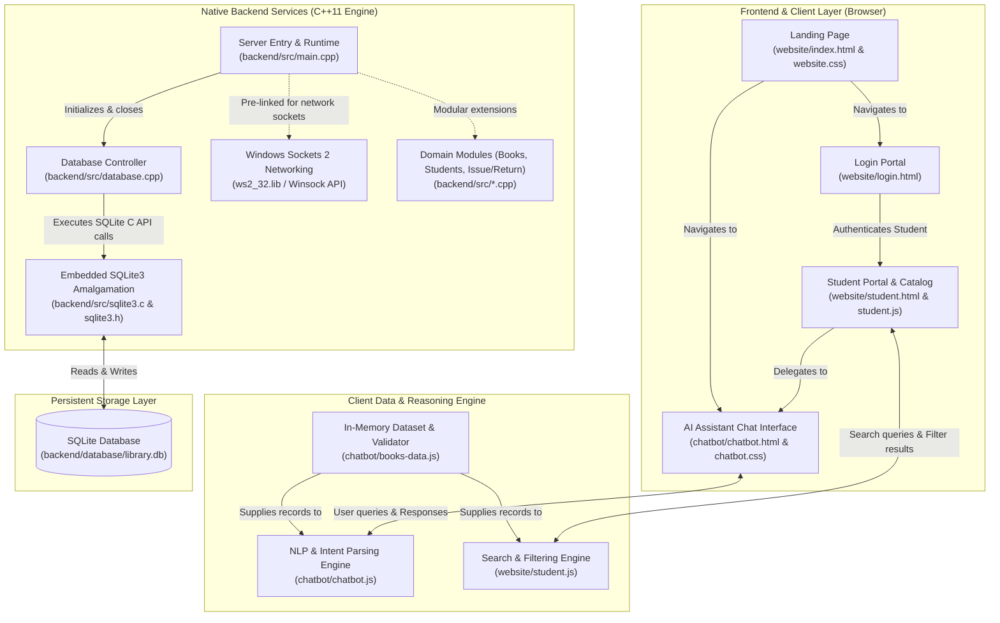
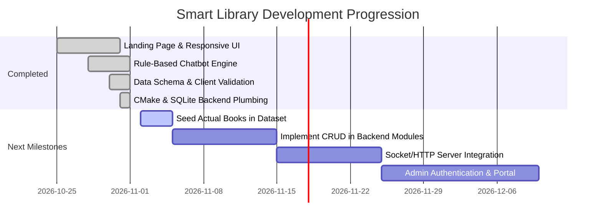

# Smart Library Management System - Comprehensive Technical Documentation

Welcome to the central technical documentation and codebase analysis for the **Smart Library Management System** (`SmartLibrary`). This document provides an exhaustive breakdown of the project's architecture, technology stack, file-by-file code purpose, internal and external APIs, data schemas, and the development roadmap.

---

## Table of Contents
1. [Project Overview](#1-project-overview)
2. [High-Level System Architecture](#2-high-level-system-architecture)
3. [Comprehensive Tech Stack Breakdown](#3-comprehensive-tech-stack-breakdown)
4. [File-by-File Purpose & Code Analysis](#4-file-by-file-purpose--code-analysis)
   - [4.1 Backend Engine (`backend/`)](#41-backend-engine-backend)
   - [4.2 Web Application & UI (`website/`)](#42-web-application--ui-website)
   - [4.3 Smart Assistant Chatbot (`chatbot/`)](#43-smart-assistant-chatbot-chatbot)
   - [4.4 Modular Architecture Scaffolding (`module1/`)](#44-modular-architecture-scaffolding-module1)
   - [4.5 Root Verification & Tooling Files](#45-root-verification--tooling-files)
5. [Important APIs & Interfaces Reference](#5-important-apis--interfaces-reference)
   - [5.1 Database & Persistence APIs (SQLite3 C/C++)](#51-database--persistence-apis-sqlite3-cc)
   - [5.2 Windows Sockets Network APIs (Winsock2 `ws2_32`)](#52-windows-sockets-network-apis-winsock2-ws2_32)
   - [5.3 Frontend & Web Browser APIs](#53-frontend--web-browser-apis)
6. [Data Model & Dataset Validation Specification](#6-data-model--dataset-validation-specification)
7. [Build, Configuration & Execution Guide](#7-build-configuration--execution-guide)
8. [Current Implementation Status & Future Roadmap](#8-current-implementation-status--future-roadmap)

---

## 1. Project Overview

The **Smart Library Management System** is a multi-tier educational software platform developed to modernize and streamline institutional library operations. It is composed of three interconnected sub-systems:

1. **Client-Facing Web Application (`website/`)**: A responsive web portal offering public discovery, dedicated login workflows for administrators and students, and an interactive book search/filtering system for patrons.
2. **Rule-Based Smart Library Assistant (`chatbot/`)**: An in-browser intelligent conversational assistant capable of answering user inquiries regarding book availability, categories, and author queries with English heuristic NLP.
3. **High-Performance C++ Native Backend (`backend/`)**: A C++11 core server application integrated with SQLite3 for local ACID-compliant database storage and linked with the Windows Sockets (`ws2_32`) API for high-throughput client-server networking.

---

## 2. High-Level System Architecture

The following diagram illustrates how the components of the Smart Library ecosystem relate to each other:



---

## 3. Comprehensive Tech Stack Breakdown

| Layer / Subsystem | Technology / Library | Version / Standard | Purpose & Role |
| :--- | :--- | :--- | :--- |
| **Backend Core** | C++ | C++11 (`-std=c++11`) | Core server logic, business transaction processing, memory management. |
| **Backend Build System** | CMake | >= 3.10 | Cross-platform build automation, dependency resolution, compiler flag orchestration. |
| **Compiler Toolchain** | MinGW-w64 / GCC | C++11 / C99 | Native 64-bit Windows binary compilation. |
| **Database Engine** | SQLite3 | 3.x (Amalgamation) | Serverless, self-contained, transactional SQL database engine compiled directly into the binary. |
| **Networking Library** | Windows Sockets 2 (Winsock) | `ws2_32` library | High-performance Windows networking for TCP/IP socket listeners and network IPC. |
| **Web Presentation** | HTML5 | Modern standard | Semantic document structure, accessibility, forms, viewport responsiveness. |
| **Web Styling** | CSS3 | Custom Responsive | Flexbox, CSS Grid layout, gradient styling, custom card components, fluid typography (`clamp`). |
| **Web Typography** | Google Fonts | `Inter` (400 to 800) | High-legibility typography for administrative dashboards and student portals. |
| **Web Client Logic** | JavaScript | ECMAScript 2015+ (ES6+) | Event handling, dynamic DOM rendering, client-side dataset searching and sorting. |
| **Chatbot Intelligence** | Vanilla JavaScript | Heuristic Pattern Matching | Regular expression intent extraction, category grouping, ASCII character boundary validation. |
| **IDE & Configuration** | Visual Studio Code | Settings Schema | CMake source directory bindings and compilation configuration. |

---

## 4. File-by-File Purpose & Code Analysis

Below is an exhaustive breakdown of every directory and file across the codebase.

```
SmartLibrary/
├── .vscode/
│   └── settings.json              # Workspace configuration for CMake
├── backend/
│   ├── CMakeLists.txt             # CMake project definition and build scripts
│   ├── database/                  # Runtime storage folder for SQLite database files
│   ├── include/
│   │   └── sqlite3.h              # SQLite3 C/C++ interface header file
│   └── src/
│       ├── books.cpp              # Book management module implementation (stub)
│       ├── database.cpp           # SQLite database connection and lifecycle handling
│       ├── issue_return.cpp       # Circulation & issue/return transaction handler (stub)
│       ├── main.cpp               # C++ backend application entry point
│       ├── sqlite3.c              # Complete SQLite3 C implementation (amalgamation)
│       └── students.cpp           # Student record management implementation (stub)
├── chatbot/
│   ├── books-data.js              # Common library book catalog dataset and validation engine
│   ├── chatbot.css                # Visual design and responsive styling for the chatbot
│   ├── chatbot.html               # Chatbot UI structure and user interaction markup
│   └── chatbot.js                 # Rule-based conversational logic and search parser
├── module1/                       # Modular architecture directory for future functional expansions
│   ├── admin/                     # Administrative controllers and view scaffolding
│   ├── books/                     # Book catalog services scaffolding
│   ├── issue-return/              # Circulation services scaffolding
│   ├── records/                   # Historical audit and record reporting scaffolding
│   └── students/                  # Student registration and account management scaffolding
├── website/
│   ├── index.html                 # Main landing page for the Smart Library portal
│   ├── login.html                 # Unified authentication view for Students and Administrators
│   ├── student.html               # Interactive student book search and catalog portal
│   ├── student.js                 # Search, multi-criteria filtering, and catalog rendering logic
│   ├── website.css                # Central stylesheets for landing page, auth, and student portal
│   └── website.js                 # Global website utilities, dynamic dates, and auth routing
├── test.cpp                       # MinGW compiler verification test source
├── test.exe                       # Compiled MinGW verification binary
├── test2.cpp                      # Secondary standard compiler test source
└── test2.exe                      # Compiled secondary verification binary
```

---

### 4.1 Backend Engine (`backend/`)

#### 1. [`backend/CMakeLists.txt`](file:///c:/Users/Pranav%20Maske/OneDrive/Desktop/SmartLibrary/backend/CMakeLists.txt)
* **Purpose**: Root CMake configuration file specifying build rules, compilation targets, language standards, include directories, and link dependencies for the C++ backend.
* **Key Directives**:
  * `cmake_minimum_required(VERSION 3.10)`: Asserts compatibility with modern CMake generators.
  * `project(SmartLibraryBackend)`: Defines the project identifier.
  * `set(CMAKE_CXX_STANDARD 11)`: Enforces modern C++11 semantics.
  * `add_executable(smartlibrary_server src/main.cpp src/database.cpp src/sqlite3.c)`: Assembles the backend executable from its core entry point, database wrapper, and embedded SQLite source.
  * `target_include_directories(smartlibrary_server PRIVATE include)`: Exposes `sqlite3.h` to the compiler.
  * `target_link_libraries(smartlibrary_server PRIVATE ws2_32)`: Links the Windows Sockets 2 API library to empower the server with network communication capabilities.

#### 2. [`backend/src/main.cpp`](file:///c:/Users/Pranav%20Maske/OneDrive/Desktop/SmartLibrary/backend/src/main.cpp)
* **Purpose**: Primary execution entry point (`main()`) for the backend server.
* **Code Logic**:
  * Outputs initial startup notifications to `std::cout`.
  * Calls `connectDatabase()` to verify and establish an operational connection to the SQLite database.
  * If the database cannot be reached or initialized, the process terminates safely with exit code `1`.
  * Prints a confirmation message verifying that the C++11 backend is running.
  * Calls `closeDatabase()` to cleanly finalize and close database handles before exiting with status code `0`.

#### 3. [`backend/src/database.cpp`](file:///c:/Users/Pranav%20Maske/OneDrive/Desktop/SmartLibrary/backend/src/database.cpp)
* **Purpose**: Manages low-level database connection state and lifecycle methods.
* **Code Logic**:
  * Declares a global database handle `sqlite3* db = NULL;`.
  * `bool connectDatabase()`:
    * Executes `sqlite3_open("database/library.db", &db)`.
    * Checks the return code against `SQLITE_OK`.
    * If an error occurs, logs diagnostic messages with `sqlite3_errmsg(db)` and returns `false`.
    * If successful, prints a success confirmation and returns `true`.
  * `void closeDatabase()`:
    * Checks if `db != NULL`.
    * Invokes `sqlite3_close(db)` to flush remaining transactions and reclaim memory.
    * Resets the pointer to `NULL` to prevent dangling references.

#### 4. [`backend/include/sqlite3.h`](file:///c:/Users/Pranav%20Maske/OneDrive/Desktop/SmartLibrary/backend/include/sqlite3.h) & [`backend/src/sqlite3.c`](file:///c:/Users/Pranav%20Maske/OneDrive/Desktop/SmartLibrary/backend/src/sqlite3.c)
* **Purpose**: Official SQLite amalgamation source and header files.
* **Technical Significance**: Embedding the amalgamation directly into the project tree eliminates the need for external dynamic link libraries (`sqlite3.dll`) or system-level package manager dependencies, guaranteeing 100% reproducible cross-platform builds.

#### 5. Domain Module Stubs:
* [`backend/src/books.cpp`](file:///c:/Users/Pranav%20Maske/OneDrive/Desktop/SmartLibrary/backend/src/books.cpp): Reserved for C++ book inventory management (CRUD operations, ISBN validation, category indexing).
* [`backend/src/students.cpp`](file:///c:/Users/Pranav%20Maske/OneDrive/Desktop/SmartLibrary/backend/src/students.cpp): Reserved for student profile tracking, library card generation, and membership authorization.
* [`backend/src/issue_return.cpp`](file:///c:/Users/Pranav%20Maske/OneDrive/Desktop/SmartLibrary/backend/src/issue_return.cpp): Reserved for circulation business logic, lending durations, fine calculation, and return processing.

#### 6. [`backend/database/`](file:///c:/Users/Pranav%20Maske/OneDrive/Desktop/SmartLibrary/backend/database)
* **Purpose**: Target directory where the SQLite runtime database (`library.db`) is created and persisted across server executions.

---

### 4.2 Web Application & UI (`website/`)

#### 1. [`website/index.html`](file:///c:/Users/Pranav%20Maske/OneDrive/Desktop/SmartLibrary/website/index.html)
* **Purpose**: Main marketing, informational, and landing page for the Smart Library platform.
* **Key Components**:
  * **Navigation Bar**: Sticky header featuring the brand logo, smooth-scrolling anchors (`#home`, `#services`, `#about`), and a direct link to the login screen.
  * **Hero Section**: Engaging headline, value proposition ("Your Knowledge. Your Future."), call-to-action buttons, and an illustrated book discovery card.
  * **Services Grid**: Interactive three-column cards linking directly to:
    1. *Admin Portal* (`login.html?role=admin`)
    2. *Student Portal* (`login.html?role=student`)
    3. *Library AI Assistant* (`../chatbot/chatbot.html`)
  * **About Us Section**: Background details and collection scale indicator.
  * **Footer**: Copyright notice and branding.

#### 2. [`website/login.html`](file:///c:/Users/Pranav%20Maske/OneDrive/Desktop/SmartLibrary/website/login.html)
* **Purpose**: Dedicated authentication portal for library patrons and staff.
* **Key Components**:
  * Dual-role selector dropdown (`Admin` vs. `Student`).
  * Email input and password field with interactive toggle ("Show" / "Hide" password).
  * URL query parameter consumption (automatically sets the role dropdown based on whether `?role=admin` or `?role=student` was passed in the URL).
  * Client-side form interceptor routing authenticated users to the corresponding dashboard.

#### 3. [`website/student.html`](file:///c:/Users/Pranav%20Maske/OneDrive/Desktop/SmartLibrary/website/student.html)
* **Purpose**: Patron dashboard enabling students to explore books, apply dynamic filters, and check real-time stock availability.
* **Key Components**:
  * **Advanced Filter Bar**:
    * Text search input (`#bookSearch`) for real-time title and author searching.
    * Dynamic category dropdown (`#categoryFilter`) populated automatically from available data.
    * Availability filter dropdown (`#availabilityFilter` with "All Books", "Available Books", and "Unavailable Books").
  * **Catalog Container**: Grid display (`#studentBookList`) rendering book cards dynamically.
  * **AI Assistant Callout**: Card with a direct link guiding students to the conversational chatbot.

#### 4. [`website/student.js`](file:///c:/Users/Pranav%20Maske/OneDrive/Desktop/SmartLibrary/website/student.js)
* **Purpose**: Client-side filtering and rendering logic for the student catalog.
* **Key Functions**:
  * `loadCategories()`: Extracts all unique, non-empty categories from `window.libraryBooks` using a JavaScript `Set`, sorts them alphabetically, and injects `<option>` elements into the category filter dropdown.
  * `displayBooks(bookArray)`: Renders book cards into `#studentBookList` with title, author, category, and an availability badge with color-coded status classes (`book-available` vs. `book-unavailable`). Also displays an empty-state message if zero books match.
  * `applyFilters()`: Combines text query searching, selected category matching, and stock availability checks (`availableCopies > 0`) simultaneously into a unified filtering pipeline triggered on every keystroke or selection change.

#### 5. [`website/website.js`](file:///c:/Users/Pranav%20Maske/OneDrive/Desktop/SmartLibrary/website/website.js)
* **Purpose**: Global utilities and authentication redirection handling.
* **Key Functions**:
  * Dynamically injects the current year into `#year` in the page footer.
  * Parses URL parameters via `URLSearchParams` on `login.html` and synchronizes the `#loginRole` dropdown.
  * Intercepts `loginForm` submission: validates input, displays status messages, and routes students to `student.html`.
  * `togglePassword()`: Utility function switching password field types between `password` and `text`.

#### 6. [`website/website.css`](file:///c:/Users/Pranav%20Maske/OneDrive/Desktop/SmartLibrary/website/website.css)
* **Purpose**: Central style sheet powering all pages in the `website/` module.
* **Design Features**:
  * Mobile-first responsive layouts with media query breakpoints at 900px, 700px, 600px, and 500px.
  * Sophisticated card shadows (`box-shadow`), CSS transformations (`transform: translateY(-5px)`), and smooth scrolling.
  * Semantic color palette: Primary Navy (`#173b65`), Primary Blue (`#2563eb`), Background Slate (`#f8fafc`), Success Green (`#16803c`), and Warning Red (`#c0392b`).

---

### 4.3 Smart Assistant Chatbot (`chatbot/`)

#### 1. [`chatbot/books-data.js`](file:///c:/Users/Pranav%20Maske/OneDrive/Desktop/SmartLibrary/chatbot/books-data.js)
* **Purpose**: Centralized in-memory dataset definition and strict client-side data validation engine.
* **Key Logic & Architecture**:
  * Exposes global dataset `window.libraryBooks`.
  * Defines `validateLibraryBooks(bookArray)`: An integrity audit function that enforces data quality:
    * Validates object types and rejects `null` or non-object records.
    * Rejects records with missing or empty `id`, `title`, or `author`.
    * Enforces integer constraints on `quantity` and `availableCopies` (must be `>= 0`).
    * Rejects logical anomalies where `availableCopies > quantity`.
    * Checks for duplicate IDs using a `Set`.
    * Strips out invalid records and logs descriptive warnings to `console.warn`.
  * Exposes metadata object `window.libraryDatasetInfo` containing total book counts, language tags, and collection provenance.

#### 2. [`chatbot/chatbot.html`](file:///c:/Users/Pranav%20Maske/OneDrive/Desktop/SmartLibrary/chatbot/chatbot.html)
* **Purpose**: Markup structure for the interactive conversational assistant interface.
* **Key Components**:
  * **Header**: Navigation back to the main portal (`← Home`), assistant status indicator (`Online | English Support`), and a "Clear Chat" button.
  * **Message Stream (`#chatMessages`)**: Scrollable area displaying conversational message bubbles with custom avatars for bot (`🤖`) and user.
  * **Suggestions Pill Tray**: Quick-action buttons ("Find programming books", "Search books by author", "Recommend a book").
  * **Input Footer**: Form container with text input, send action button (`Send ➤`), and data limitation disclaimers.

#### 3. [`chatbot/chatbot.js`](file:///c:/Users/Pranav%20Maske/OneDrive/Desktop/SmartLibrary/chatbot/chatbot.js)
* **Purpose**: Conversational heuristic parser and rule-based NLP response engine.
* **Core Functions & Intent Handling**:
  * **ASCII / English Boundary Checking**: Enforces `!/^[\x00-\x7F]*$/` to reject non-English characters gracefully.
  * **Intent Classification Engine (`getBotResponse(message)`)**:
    * `help` / `what can you do`: Returns capabilities and sample queries.
    * `hi` / `hello` / `hey`: Returns friendly introductory greetings.
    * `show all books` / `all books`: Formats and lists the entire catalog.
    * `list categories`: Aggregates distinct categories and presents them as a bulleted list.
    * `how many books` / `total books`: Returns total dataset size.
    * `how many available`: Computes real-time availability ratios.
    * `show available books` / `show unavailable books`: Filters and presents books by availability state.
    * `recommend [category]` / `suggest a book`: Uses regular expressions to extract subject categories and matches related titles.
    * `author [name]` / `written by`: Strips filler stop-words and matches authors.
    * `is [title] available`: Formats book-specific inventory availability status.
    * *General Search Fallback*: Performs a multi-property substring match against titles, authors, and categories.
  * `addMessage(message, sender)`: Appends messages and scrolls the container to the newest message automatically.
  * `clearChat`: Wipes the message history and resets the assistant greeting.

#### 4. [`chatbot/chatbot.css`](file:///c:/Users/Pranav%20Maske/OneDrive/Desktop/SmartLibrary/chatbot/chatbot.css)
* **Purpose**: Dedicated stylesheet styling the conversational assistant.
* **Design Features**:
  * Dedicated application container with max dimensions (`1000px` width, `95vh` height) and card elevation.
  * Distinct styling for bot messages (neutral grey `#f1f5f9` aligned to the left) vs. user messages (brand blue `#2563eb` aligned to the right).
  * Clickable suggestion pill buttons with hover states.
  * Full mobile responsiveness for devices under `600px` using `100dvh` (dynamic viewport height).

---

### 4.4 Modular Architecture Scaffolding (`module1/`)

The `module1/` folder represents a planned directory structure for modular system scaling:
* [`module1/admin/`](file:///c:/Users/Pranav%20Maske/OneDrive/Desktop/SmartLibrary/module1/admin): Reserved for administrative dashboards, user permission management, and staff audit trails.
* [`module1/books/`](file:///c:/Users/Pranav%20Maske/OneDrive/Desktop/SmartLibrary/module1/books): Reserved for advanced book acquisition, cataloging, barcode/RFID integration.
* [`module1/issue-return/`](file:///c:/Users/Pranav%20Maske/OneDrive/Desktop/SmartLibrary/module1/issue-return): Reserved for check-out and return desks, reservation queues, and renewals.
* [`module1/records/`](file:///c:/Users/Pranav%20Maske/OneDrive/Desktop/SmartLibrary/module1/records): Reserved for transactional logs, inventory audits, and overdue analytics.
* [`module1/students/`](file:///c:/Users/Pranav%20Maske/OneDrive/Desktop/SmartLibrary/module1/students): Reserved for patron onboarding, identity verification, and loan quotas.

---

### 4.5 Root Verification & Tooling Files

* [`.vscode/settings.json`](file:///c:/Users/Pranav%20Maske/OneDrive/Desktop/SmartLibrary/.vscode/settings.json): Contains workspace-level VS Code configuration pointing the CMake extension to `backend/` as the primary source directory.
* [`test.cpp`](file:///c:/Users/Pranav%20Maske/OneDrive/Desktop/SmartLibrary/test.cpp) & [`test.exe`](file:///c:/Users/Pranav%20Maske/OneDrive/Desktop/SmartLibrary/test.exe): Standalone C++ verification script used to validate the MinGW-w64 toolchain configuration on the host environment.
* [`test2.cpp`](file:///c:/Users/Pranav%20Maske/OneDrive/Desktop/SmartLibrary/test2.cpp) & [`test2.exe`](file:///c:/Users/Pranav%20Maske/OneDrive/Desktop/SmartLibrary/test2.exe): Secondary verification script validating standard console output and GCC compiler operation.

---

## 5. Important APIs & Interfaces Reference

### 5.1 Database & Persistence APIs (SQLite3 C/C++)

The backend interfaces with SQLite via the standard C API exposed in [`sqlite3.h`](file:///c:/Users/Pranav%20Maske/OneDrive/Desktop/SmartLibrary/backend/include/sqlite3.h):

| API Signature | Location in Code | Purpose & Functionality |
| :--- | :--- | :--- |
| `int sqlite3_open(const char *filename, sqlite3 **ppDb)` | `backend/src/database.cpp:12` | Opens a connection to the SQLite database file (`database/library.db`). If the file does not exist, SQLite creates it automatically. Returns `SQLITE_OK` (0) upon success. |
| `const char *sqlite3_errmsg(sqlite3 *db)` | `backend/src/database.cpp:17` | Extracts an English description of the most recent error condition encountered by an SQLite API call on the specified database handle. |
| `int sqlite3_close(sqlite3 *db)` | `backend/src/database.cpp:31` | Closes the open database connection handle, deallocates associated memory structures, and invalidates any cached statements. |

#### Planned Core SQLite APIs for Domain Modules:
* `int sqlite3_prepare_v2(sqlite3 *db, const char *zSql, int nByte, sqlite3_stmt **ppStmt, const char **pzTail)`: Compiles SQL text into prepared bytecode statements.
* `int sqlite3_step(sqlite3_stmt *pStmt)`: Evaluates a prepared bytecode statement (advancing through record result sets or executing mutations).
* `int sqlite3_bind_*(sqlite3_stmt *pStmt, int index, ...)`: Binds parameter values to SQL placeholders (`?`) to prevent SQL injection vulnerabilities.
* `const unsigned char *sqlite3_column_text(sqlite3_stmt *pStmt, int iCol)`: Extracts text column data from the active row of a query result.
* `int sqlite3_finalize(sqlite3_stmt *pStmt)`: Destroys a prepared statement to prevent memory leaks.

---

### 5.2 Windows Sockets Network APIs (Winsock2 `ws2_32`)

The backend links directly against `ws2_32.lib` via `backend/CMakeLists.txt`. This provides the networking foundation for client-server IPC and socket servers:

| Winsock API Function | Header | Intended Role |
| :--- | :--- | :--- |
| `int WSAStartup(WORD wVersionRequired, LPWSADATA lpWSAData)` | `<winsock2.h>` | Initializes the underlying Windows Sockets DLL subsystem for the calling process. |
| `SOCKET socket(int af, int type, int protocol)` | `<winsock2.h>` | Creates a socket bound to a specific transport service provider (e.g. `AF_INET`, `SOCK_STREAM`, `IPPROTO_TCP`). |
| `int bind(SOCKET s, const sockaddr *name, int namelen)` | `<winsock2.h>` | Associates a local network address and port number with the created socket. |
| `int listen(SOCKET s, int backlog)` | `<winsock2.h>` | Places a socket in a state where it listens for incoming client connections. |
| `SOCKET accept(SOCKET s, sockaddr *addr, int *addrlen)` | `<winsock2.h>` | Permits an incoming connection attempt on a listening socket and creates a dedicated client socket. |
| `int recv(SOCKET s, char *buf, int len, int flags)` | `<winsock2.h>` | Reads incoming network payloads sent by frontend or desktop clients. |
| `int send(SOCKET s, const char *buf, int len, int flags)` | `<winsock2.h>` | Dispatches payload buffers over an established connection. |
| `int closesocket(SOCKET s)` / `WSACleanup()` | `<winsock2.h>` | Closes active sockets and releases Winsock socket resources. |

---

### 5.3 Frontend & Web Browser APIs

The client scripts utilize native browser Web APIs without third-party framework overhead:

| API / Interface | Files Utilizing | Purpose & Description |
| :--- | :--- | :--- |
| `URLSearchParams` | `website/website.js` | Parses query parameters from `window.location.search` (e.g. extracting `?role=student` to preselect login roles). |
| `document.addEventListener("DOMContentLoaded")` | `website.js`, `student.js`, `chatbot.js` | Defers script execution until the full DOM hierarchy is parsed and ready. |
| `Element.scrollTop` / `Element.scrollHeight` | `chatbot/chatbot.js` | Controls scroll dynamics, keeping the newest conversation messages in the viewport. |
| `RegExp.test()` / `String.match()` | `chatbot/chatbot.js` | Performs pattern matching for category extraction and ASCII character validation. |
| `Set` Collection | `chatbot/books-data.js`, `student.js` | Enforces uniqueness when tracking book IDs and generating distinct category filters. |
| `Array.prototype.filter()`, `.map()`, `.sort()` | `student.js`, `chatbot.js` | Powers real-time search queries and catalog filtering without mutating source arrays. |

---

## 6. Data Model & Dataset Validation Specification

### 6.1 Book Record Schema

The book record model used across `books-data.js`, `student.js`, and `chatbot.js` follows this specification:

```typescript
interface LibraryBook {
    id: number | string;        // Unique identifier for the book
    title: string;              // Full title of the book (non-empty)
    author: string;             // Author name (non-empty)
    category?: string;          // Literary or academic classification (e.g., "Programming")
    quantity?: number;          // Total copies owned by the institution (>= 0)
    availableCopies?: number;   // Copies currently physically on shelf (0 <= availableCopies <= quantity)
}
```

### 6.2 Validation Rules Enforced by `validateLibraryBooks()`

1. **Object Verification**: Each entry must be a valid, non-null JavaScript object.
2. **Mandatory Identifiers**: `id` cannot be null, undefined, or an empty string. All IDs must be unique across the collection.
3. **Mandatory Text Attributes**: `title` and `author` must be valid strings containing non-whitespace characters.
4. **Non-Negative Quantities**: `quantity` and `availableCopies`, when specified, must be integers greater than or equal to `0`.
5. **Logical Boundary**: `availableCopies` cannot exceed `quantity`. Any record where `availableCopies > quantity` is flagged as an invalid record and omitted from the active catalog.

---

## 7. Build, Configuration & Execution Guide

### 7.1 Prerequisites
* **C++ Compiler**: MinGW-w64 (GCC >= 7.0 recommended, with C++11 support)
* **Build System**: CMake (version 3.10 or newer)
* **Web Browser**: Any modern evergreen browser (Google Chrome, Mozilla Firefox, Microsoft Edge)

### 7.2 Building the C++ Backend

Open a terminal (e.g., PowerShell) and navigate to the backend directory:

```powershell
# Navigate to the backend directory
cd "C:\Users\Pranav Maske\OneDrive\Desktop\SmartLibrary\backend"

# Generate build files using CMake
cmake -B build -G "MinGW Makefiles"

# Compile the target executable
cmake --build build
```

The resulting binary `smartlibrary_server.exe` will be located under `backend/build/`.

### 7.3 Running the Backend
```powershell
# Execute the compiled server
.\build\smartlibrary_server.exe
```

Expected output:
```text
Smart Library Backend Starting...
Database connected successfully!
C++11 Backend is Running!
```

### 7.4 Running the Web Application & Chatbot
Because the frontend and chatbot are built using pure standard web technologies, they do not require an `npm install` or local Node.js bundling step:
* **Landing Page**: Open `website/index.html` in your web browser.
* **Student Catalog**: Open `website/student.html` directly or navigate to it from the login screen.
* **AI Chatbot**: Open `chatbot/chatbot.html` in your web browser.

---

## 8. Current Implementation Status & Future Roadmap



### 8.1 Completed Milestones
* Fully styled responsive web portal (Landing page, Student Portal, Login UI).
* Real-time search and multi-criteria book filtering in the student interface.
* In-browser conversational assistant with pattern-matching intent resolution.
* Data integrity validator for book records.
* Embedded SQLite3 compilation setup with database open/close verification.
* Sockets network library link configured (`ws2_32`).

### 8.2 In-Progress & Recommended Next Steps
1. **Populate Dataset Records**: Add the initial collection records to `window.libraryBooks` inside `chatbot/books-data.js` so both the student portal and chatbot display real catalog items immediately.
2. **Implement C++ Module Stubs**:
   * Flesh out `backend/src/books.cpp` with SQL table creation (`CREATE TABLE IF NOT EXISTS books (...)`) and book insertion/query routines.
   * Implement student registration logic in `backend/src/students.cpp`.
   * Implement issue and return transaction tracking in `backend/src/issue_return.cpp`.
3. **Bridge Frontend and Backend**:
   * Implement a lightweight HTTP daemon or TCP socket listener in `backend/src/main.cpp` using Winsock2.
   * Replace client-side static mock datasets with asynchronous `fetch()` API calls against the C++ backend endpoints.
4. **Implement Real Authentication**: Connect `website/login.html` to a secure hashing and verification mechanism in the backend for administrators and students.

---
*Documentation compiled and maintained for the Smart Library Management System project.*

